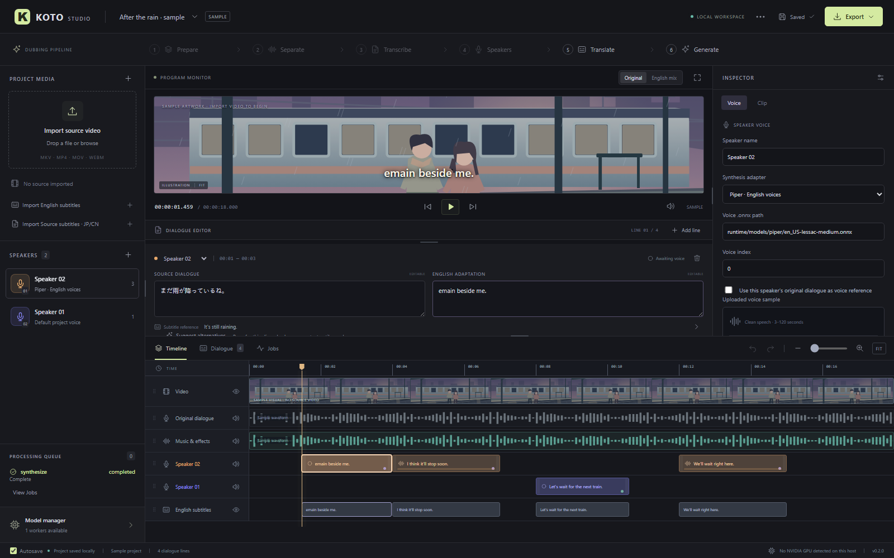

# KOTO Studio

**A local AI dubbing studio for Windows and NVIDIA GPUs.**

Turn Japanese or Chinese video dialogue into an editable English dub. Import a
video, separate dialogue from background audio, identify speakers, translate,
assign voices, review timing, and render—all from a timeline-based editor.

KOTO is in active development. Version 0.2.5 marks the current working baseline, including the recent editing, generation,
and export improvements.

[Download 0.2.5 alpha ZIP](https://github.com/katfacey/koto-studio/releases/download/v0.2.5/KOTO-Studio-v0.2.5.zip)
· [Source ZIP](https://github.com/katfacey/koto-studio/archive/refs/heads/main.zip)
· [Setup guide](docs/SETUP.md)
· [Changelog](CHANGELOG.md)
· [Validation](VALIDATION.md)



*Actual Windows browser screenshot from the validation workflow. The built-in
sample uses labeled illustration and example dialogue; it includes no source
video. The screenshot shows version 0.2.5 with real Piper takes generated during
the checks.*

### Advisement:

This is a WiP, and currently made for **my** specific PC specs:
- Windows 11
- RTX 5090

IDK if it'll work on other platforms/configurations. Installation is a bit janky right now, as well: run a bunch of `name.cmd`'s and then do **`start.cmd`**.
I'll work on this as time goes on, implementing a few fixes/changes.
The current state is more of a *proof of concept* rather than a true-blue piece of software. However, it did function on a technical level, so it can only get better from here.

## What you can do

- **Prepare video and audio.** Inspect MKV/MP4/MOV/WebM tracks, extract audio,
  create a browser preview, and import text subtitles.
- **Build an English dub.** Separate vocals/background, transcribe Japanese or
  Chinese, diarize speakers, translate locally, and edit every line.
- **Choose voices per character.** Use Piper voices, XTTS with an uploaded sample
  or the speaker's original dialogue, or a trusted custom model adapter.
- **Correct the timeline.** Move clips between speaker tracks, retime and trim,
  reorder speaker lanes, mute tracks, hide video/subtitles, and undo edits.
- **Generate efficiently.** Piper and XTTS reuse the loaded voice/reference for
  a speaker's batch. Generate the project, one speaker, or one selected line.
- **Review and render.** Preview the English mix, see timing hints, adjust speech
  speed, request alternate translations per clip, and export MKV or MP4.
- **Keep working safely.** Autosave, editable project data, visible job progress,
  cancellation, and retry preserve completed voice takes.

## Quick start on Windows

1. **Download and extract the whole ZIP** into a writable folder. Keep the folder
   contents together. Do not run it from inside the archive.
2. **Run `Install.cmd`.** It installs private Python, UV, FFmpeg, and the core
   packages inside that folder.
3. **Run `Install-Models.cmd`** to choose the AI workers you want. Piper is the
   simplest starting voice. Install local translation and diarization weights
   separately if you want those stages.
4. **Run `Start.cmd`.** The editor opens at `http://127.0.0.1:8765`.
5. Import a video and follow the workflow below. Keep the terminal open while
   using KOTO; close the session with Ctrl+C when finished.

This is a **self-contained Windows environment with a browser editor**. A signed
Windows executable and a Pinokio installer are not included. You do not need
system Python, Node/npm, FFmpeg, Ollama, or a separately installed CUDA toolkit.
Installers use app-owned runtimes and leave your system PATH alone.

### Requirements

| Item | What to expect |
| --- | --- |
| Operating system | Windows 10/11 x64 and a modern browser |
| GPU | NVIDIA with a compatible driver for GPU workers; designed around an RTX 5090, 32 GB VRAM |
| CPU operation | Core editing/export and Piper work without a GPU; XTTS also has a tested CPU path |
| Storage | Plan for tens of GB for the full model set, plus videos, PCM stems, and render intermediates |
| Internet | Needed for initial packages/models and any later downloads; configured local inference stays on the machine |
| Hugging Face account | Needed to accept access agreements and download gated pyannote diarization weights |

The ZIP contains source and the built editor. It downloads runtime/model files
at setup; it is **not an offline bundle of all model weights**. GPU inference and
voice similarity still need evaluation on the target PC.

### Updating an existing installation

Close KOTO. Back up the whole `data/` folder, then copy the new ZIP's contents into
**the existing app folder**. Keep `data/`, `runtime/`, `.venv/`, and `.workers/`.
Run `Start.cmd` and refresh the editor with **Ctrl+F5**. You do not need to rename
an older installation folder to match the new version.

If you move the installation to a different path, rerun `Install.cmd` and the
optional installers you use to repair virtual environment paths. See the
[setup guide](docs/SETUP.md) and [local workspace guide](LOCAL-WORKSPACE.md).

## From source video to English dub

1. **Import and Prepare.** Choose source video/audio/subtitle tracks. Prepare
   extracts audio and creates a preview. Import SRT, VTT, ASS, or SSA separately
   when needed. Image-based PGS/DVD/DVB subtitles need external OCR.
2. **Separate.** Create dialogue and music/effects stems. Listen for residual
   speech and lost effects; separation quality varies.
3. **Transcribe and Speakers.** Choose Japanese, Chinese, or automatic detection.
   Diarization suggests speaker assignments; drag misattributed clips to the
   correct speaker lane. Manual assignment is also available.
4. **Translate.** Review the English adaptation beside the source and subtitle
   reference. Edit meaning, wording, and pacing before generating speech.
5. **Assign voices and Generate.** Choose project defaults or speaker overrides.
   Use an uploaded reference or original dialogue with XTTS. Generate missing
   lines together, or regenerate only the selected line.
6. **Review.** Successful generation selects **English mix**. Preview takes,
   adjust timing/levels, and use **Suggest alternatives** for individual lines.
7. **Export.** Choose separated background, original mix, or silence; choose MKV
   or MP4. Track mutes and visibility apply to the render. Download the video,
   mixed WAV, and English subtitles from Export or Jobs.

### Timing warnings allow rendering

English delivery can be longer than the original line. Clip indicators show
rough text estimates before synthesis and measured take duration afterward.
Automatic fitting stays within **0.80–1.25×**; manual speed changes are reversible.

Export recommends fixing overlong audio and offers **Review clip**, speed fitting,
or extending into a free gap. You may choose **Render anyway**. Takes play in full
at their existing start times, so they can overlap later dialogue. Audio that runs
past the source video's end extends the exported audio duration beyond the video
track. The choice does not move clips or apply additional speed changes.

Missing or outdated voice takes still need replacement audio. Detailed timing
warnings remain in **Jobs** after a successful export.

## Models and installers

Each processing stage has its own adapter and settings in **Model manager**.
Voices can override those settings per speaker.

| Stage | Included adapter | Installer/setup |
| --- | --- | --- |
| Dialogue/background separation | Demucs; MDX-Net, VR, BS-RoFormer via audio-separator | `Install-Models.cmd` / `Install-Separation.cmd` |
| Speech recognition | faster-whisper | `Install-Models.cmd` |
| Speaker diarization | pyannote | `Install-Diarization.cmd`; gated model access required |
| English translation | Local Ollama + Qwen3 | `Install-Translation.cmd` |
| Fixed English voices | Piper | `Install-Piper.cmd` |
| Reference-conditioned speech | XTTS-v2 | `Install-Reference-Voices.cmd` |
| Other models / voice conversion | Custom worker protocol | [Model adapter documentation](models/README.md) |

**Use original dialogue as voice reference** selects XTTS when needed. KOTO builds
and caches up to 12 seconds of non-overlapping source dialogue; at least 3 seconds
is required. Changing English clip timing keeps the original reference timestamps.
Piper uses fixed voices. XTTS approximates the reference voice; results vary.

Generation keeps imported and current cached takes. Cancellation preserves
completed lines; retry generates the remaining ones. A separate conversion worker
uses the per-line path unless the integration owns batching itself.

[Detailed model setup, download behavior, and storage locations →](docs/SETUP.md)

## Useful controls

| Action | Control |
| --- | --- |
| Play/pause | Space, when outside a text field |
| Save now | Ctrl+S; autosave is enabled by default |
| Delete selected clip | Delete or Backspace, outside text fields |
| Undo/redo | Ctrl+Z / Ctrl+Shift+Z |
| Correct a speaker | Drag the clip to another speaker lane; hold Shift to preserve its time |
| Reorder speaker tracks | Drag a lane grip; focused grips support arrow keys |
| Resize panels | Drag dividers; double-click to reset |
| Mute/hide tracks | Speaker/volume or eye controls on the track |

## Troubleshooting

| Symptom | What to check |
| --- | --- |
| Prepare fails on subtitles | Set Subtitle track to None and Prepare again; import text subtitles separately. OCR is not included. |
| Diarization needs a pipeline YAML | Run `Install-Diarization.cmd` after accepting the Hugging Face access agreements. |
| Generate mentions an older/moved Python | Close KOTO and rerun the selected worker's installer in the current folder. |
| Generate has no English text | Translate or enter an English adaptation first. |
| Generated voices seem silent | Select English mix; check speaker and monitor mutes and the background choice. |
| Render is disabled | Check for missing unmuted takes, missing source video, or an active job. Long timing alone is a warning. |
| A job fails or appears stuck | Open Jobs for the exact status/error. Cancel or retry using the current project settings. |
| Browser still shows old behavior | Restart KOTO and press Ctrl+F5. |

## Current boundaries

KOTO 0.2.5 is an editable dubbing workflow, not a full general-purpose video editor.
It does not include video inpainting, automatic lip sync, subtitle OCR, isolated
sources for simultaneously speaking characters, a bundled pretrained RVC model,
cloud inference, or a signed desktop installer. Custom adapters can connect other
local tools. Native pywebview mode is optional and needs additional setup.

Project data lives in `data/`; original media and generated assets stay on disk.
Back up the **whole folder**. Project JSON alone is not a media bundle, and automatic
cache cleanup and project JSON reimport are not included yet.

## Separation workspace (development branch)

The new separation controls are on `main`; the **0.2.5 alpha ZIP keeps its original
release contents**. Use Download source (main) to test these additions.

1. Run **Install-Separation.cmd**, then restart KOTO. This installs a dedicated
   `.workers/separator` environment using app-owned Python,
   CUDA libraries and ONNX Runtime. Existing Demucs remains available.
2. Prepare your source, click **Separate**, and choose the engine and model.
   Download the selected weights explicitly. MDX Inst HQ 3 is about 64 MiB,
   VR HP Karaoke about 121 MiB, and BS-RoFormer Viperx about 610 MiB.
3. Choose a source range, use the selected clip's original bounds, or start from
   the playhead. Preview up to 120 seconds; 30–60 seconds is a useful first test.
4. Compare **Original / Dialogue / Background** at the same playback position.
   Check lost speech, dialogue leaking into the bed, music, and effects.
5. Run **Separate full video** when satisfied. Full results become active when
   the prepared source still matches. Use **Use in project** to select an older
   full result. Previews never replace project stems or invalidate an export.

Model controls vary by architecture: MDX overlap/batch/denoise, VR aggression,
batch/TTA, and RoFormer overlap count/batch. Smaller batches use less memory.
CUDA errors are surfaced; choose CPU explicitly if needed. Weights stay in
`runtime/models/separation`, with downloaded-file receipts. Inference uses local
weights and bundled configuration without fetching model metadata.

Results retain their engine/settings, source identity, range, and audio files in
project history. Changing the prepared source makes old full results ineligible
for activation. Switching stems invalidates generated takes that use original
speaker references. History currently grows until the project is removed;
ensembles and storage cleanup controls are future work.

[Windows screenshot of the separation panel](docs/images/separation-windows.png)
shows its model setup state before installing the new worker and weights.

The panel is a functional first pass. Backend APIs own model provisioning and
result history so a future GUI redesign can reuse them; see
[separation API and architecture](docs/SEPARATION.md).

## Reusable character voices (development branch)

Save speaker voices to a shared library, assign them in other projects, and keep
specific profile versions pinned. The clip inspector adds independent engine,
reference, seed and supported delivery overrides, plus saved-take selection.
Changing wording or voice settings retains older generated/imported takes.

Run **Install-Qwen-Voices.cmd** for local reference cloning, or
**Install-Voice-Design.cmd** to add description-based voice auditions. Save a
chosen audition as a reference voice to maintain its identity across many lines.
Workers and versioned model snapshots stay inside the app folder. The later GUI
redesign can reuse the same library APIs.

[Actual Windows voice-library screenshot](docs/images/voice-library-windows.png).
See [voice setup, storage and API](docs/VOICES.md). DramaBox has been evaluated as
an expressive future engine; it is not presented as a working built-in adapter
without Windows/5090 validation. These additions are on `main`, not in the
unchanged 0.2.5 release ZIP.

## Development and validation

The backend uses Python/FastAPI, SQLite projects, FFmpeg media processing, and
isolated model workers. The frontend is dependency-free JavaScript, HTML, and CSS.

```powershell
# From an installed Windows app folder:
& '.\.venv\Scripts\python.exe' scripts\build_frontend.py
& '.\runtime\uv\uv.exe' --no-config pip install --python '.\.venv\Scripts\python.exe' -r backend\requirements-dev.txt
& '.\.venv\Scripts\python.exe' -m unittest discover -s backend\tests -v
```

Node is optional for frontend checks: `node frontend/check-ui.mjs`,
`node frontend/check-timeline.mjs`, and `node frontend/check-layout.mjs`.
The API reference is served at `/docs` while KOTO runs.

The established baseline passed **37 backend tests**, actual Windows Chromium
editing/playback/export checks, and real Piper/XTTS batch synthesis using app-owned
runtimes with only Windows System32 on PATH. See [VALIDATION.md](VALIDATION.md) for
reproducible checks, exact run links, and what still needs target-machine testing.

## Planned improvements

Future releases will focus on improving the GUI, speeding up processing, and adding
quality-of-life features that are not implemented yet. Planned areas include clearer
editing/navigation, better generation and queue feedback, more efficient model use,
and easier project and media management. These are development goals; specific
features and release dates will depend on testing and feedback.

## Upstream projects

KOTO builds on [FFmpeg](https://ffmpeg.org/), [faster-whisper](https://github.com/SYSTRAN/faster-whisper),
[Demucs](https://github.com/facebookresearch/demucs), [pyannote](https://github.com/pyannote/pyannote-audio),
[Piper](https://github.com/OHF-Voice/piper1-gpl), [Coqui TTS](https://github.com/idiap/coqui-ai-TTS),
and [Ollama](https://github.com/ollama/ollama). Dependency and model licenses apply
separately; official [XTTS-v2 weights](https://huggingface.co/coqui/XTTS-v2) use the
Coqui Public Model License. Review the relevant upstream terms when choosing a model.

[Prepared repository description and researched topics](docs/REPOSITORY.md)

## License

KOTO Studio's original source code is available under the [MIT License](LICENSE).
Third-party dependencies, engines, and model weights retain their own licenses;
the MIT license does not replace those upstream terms.

## Development credit

KOTO Studio was developed with assistance from OpenAI’s ChatGPT/Codex, including
implementation, debugging, test development, and documentation, guided by the
project creator’s requirements and feedback.
